  

  
  
  

---

## 👋 About Me

I'm an AI/ML Engineer with a background in Computer Science, focused on building practical AI-powered applications and integrating AI into real-world products.

Previously, I worked as an AI/ML Engineer at **Canopas**, contributing to production AI features involving LLMs, RAG pipelines, agentic systems, and model fine-tuning.

I'm interested in machine learning, model development, and building reliable, scalable AI-powered systems. I enjoy learning new technologies and turning ideas into practical solutions.

---

## 🛠️ Tech Stack

**AI & Specializations**

`LLMs` · `RAG Pipelines` · `Agentic AI` · `Model Fine-Tuning` · `LangChain` · `Hugging Face`

**Languages, Frameworks & Cloud**

  

---

  <i>Engineering intelligent systems with real-world impact.</i>

  

